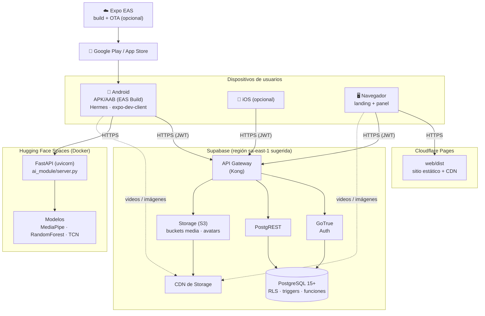
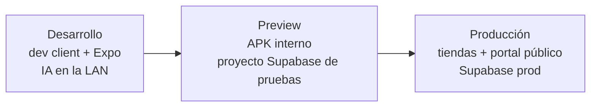

# 5. Despliegue

## 5.1 Topología



## 5.2 Componentes y configuración

| Nodo | Artefacto | Configuración |
|---|---|---|
| App móvil | build de EAS (`pnpm build:preview` o producción) | `EXPO_PUBLIC_SUPABASE_URL`, `EXPO_PUBLIC_SUPABASE_ANON_KEY`, `EXPO_PUBLIC_AI_SERVER_URL` (en `eas.json`, por perfil) |
| Portal web | Cloudflare Pages (`web/`, ver 5.6) | `VITE_SUPABASE_URL`, `VITE_SUPABASE_ANON_KEY`, `VITE_ANDROID_URL`, `VITE_IOS_URL`. Cabeceras y CSP en `web/public/_headers`. |
| Supabase | SQL de `supabase/` | Ejecutar en orden: `catalog.sql`, `dictionary.sql`, `signs.sql` (solo la primera vez) → `migrations/*.sql` |
| Servidor IA | Hugging Face Spaces, Docker (`ai_module/Dockerfile`, ver 5.7) | Se publica solo desde `main` con `.github/workflows/desplegar-ia.yml`. En local: `uvicorn server:app --host 0.0.0.0 --port 8000`. |

**SeñaPlay no tiene API propia:** la app y el portal hablan directo con Supabase (`supabase-js` + RLS). Por eso la **Data API de Supabase debe quedar activada**: desactivarla, como se recomienda para proyectos con API Node (por ejemplo, la guía de `docs/replicar/`), deja sin datos a la app y al portal.

## 5.3 Puesta en producción (checklist)

1. **Base de datos:** ejecutar las migraciones en orden y verificar localmente con `pnpm test:sql`.
2. **Primer administrador:** `update public.profiles set role = 'admin' where email = '…';` en el SQL Editor.
3. **IA (5.7):** publicar el Space y verificar `GET /`. Anotar su URL.
4. **Portal (5.6):** conectar el repositorio a Cloudflare Pages.
5. **Auth:** agregar `senaplay://auth/callback` y el dominio del portal (`https://<proyecto>.pages.dev` o el propio) a las URL de redirección permitidas.
6. **App:** `EXPO_PUBLIC_AI_SERVER_URL` con la URL del Space en `eas.json`, `pnpm verify:bundle` y `eas build --profile production`.
7. **Configuración remota:** revisar `appVersion.minimum` antes de publicar una versión incompatible.

Todo sale de la rama `main`, que está protegida: los cambios entran por Pull Request desde `gestilingo-dev`.

> ⚠️ Una vez que el contenido se edite desde el panel, **no vuelvas a ejecutar** `catalog.sql`, `dictionary.sql` ni `signs.sql`: truncan las tablas.

## 5.4 Identificadores de la app

| Identificador | Valor |
|---|---|
| Nombre visible | SeñaPlay |
| `slug` (Expo/EAS) | `senaplay` |
| `scheme` (deep links, retorno de OAuth) | `senaplay` → `senaplay://auth/callback` |
| Android `package` / iOS `bundleIdentifier` | `com.benjajadev.senaplay` |
| Prefijo de almacenamiento local | `senaplay.*` (migra `oratiolingo.*` al iniciar) |

**Pasos únicos tras el cambio de identificadores** (antes eran `oratioLingoRN`, `oratiolingo` y `com.benjajadev.oratiolingo`):

1. **EAS:** el `projectId` anterior estaba vinculado al slug viejo y se quitó de `app.json`. Ejecuta `npx eas-cli init`, que crea o vincula el proyecto `senaplay` y agrega el nuevo `projectId`. Luego haz `pnpm build:dev` (el paquete nuevo genera credenciales nuevas).
2. **Supabase → Authentication → URL Configuration:** agrega `senaplay://auth/callback` a las URL de redirección y quita la antigua cuando ya nadie use la versión vieja.
3. **Dispositivos de prueba:** desinstala la app anterior. Android la trata como otra aplicación porque el paquete es distinto.
4. **Proveedores OAuth** (Google, Facebook, X): si alguno tiene configurado el paquete de Android (por ejemplo, SHA-1 más `package`), actualízalo a `com.benjajadev.senaplay`.

## 5.5 Entornos



Cada entorno usa sus propias variables `EXPO_PUBLIC_*` y `VITE_*`. El código no cambia entre entornos.

## 5.6 Portal en Cloudflare Pages

1. <https://dash.cloudflare.com> → **Workers & Pages → Create → Pages → Connect to Git** → `BenjajaDev/oratioLingoRN`, rama **`main`**.
2. **Build**:

   | Campo | Valor |
   |---|---|
   | Framework preset | `None` |
   | Root directory | `web` |
   | Build command | `npx pnpm@10.28.0 install --frozen-lockfile --ignore-workspace && npx pnpm@10.28.0 run --ignore-workspace build` |
   | Build output directory | `dist` |

   `--ignore-workspace` es obligatorio: sin él, pnpm toma el `pnpm-workspace.yaml` de la raíz e instala las dependencias de la app Expo en vez de las del portal (pnpm 10 no respeta el `ignore-workspace` de `web/.npmrc`).

3. **Settings → Variables and Secrets** (Production, y Preview si se usa):

   | Nombre | Valor |
   |---|---|
   | `VITE_SUPABASE_URL` | URL del proyecto de Supabase |
   | `VITE_SUPABASE_ANON_KEY` | Clave *publishable* (nunca la *service role*) |
   | `VITE_ANDROID_URL` / `VITE_IOS_URL` | Enlaces de las tiendas (opcional) |
   | `NODE_VERSION` | `22.22.0` |
   | `SKIP_DEPENDENCY_INSTALL` | `true` |

4. **Deployments → Retry deployment** (las variables solo se aplican en un deploy nuevo).
5. Verificar en `https://<proyecto>.pages.dev`: la portada carga contenido, `/admin` permite entrar y recargar una ruta interna (por ejemplo `/admin/media`) no da 404. Cloudflare trata el sitio como SPA porque no hay `404.html`: no agregar uno.

La CSP de `web/public/_headers` permite Supabase (`*.supabase.co`, también `wss` para Realtime) y Google Fonts. Si el portal empieza a cargar recursos de otro dominio, hay que sumarlo ahí.

## 5.7 Servidor de IA en Hugging Face Spaces

El servidor usa ~500 MB de RAM con los dos modelos cargados, más que los 512 MB del plan gratis de Render. El plan gratis de Spaces (CPU Basic) da 2 vCPU y 16 GB. Se duerme tras 48 h sin uso; la primera petición después tarda 1–3 min en despertarlo.

**Una vez:**

1. Cuenta en <https://huggingface.co> → **Settings → Access Tokens → Create new token**, tipo *Write*.
2. En GitHub, **Settings → Secrets and variables → Actions**:
   - *Secret* `HF_TOKEN` con ese token.
   - *Variable* `HF_SPACE` con `usuario-de-hf/senaplay-ia`.
3. **Actions → Desplegar IA → Run workflow** (o cualquier push a `main` que toque `ai_module/`). El script crea el Space si no existe y sube solo código, config y modelos.

**Verificar** en `https://<usuario-de-hf>-senaplay-ia.hf.space/`:

```json
{"app": "SeñaPlay IA de Señas", "modelo_estatico_listo": true, "modelo_dinamico_listo": true, ...}
```

**Probar la imagen en local** antes de publicar:

```bash
docker build -t senaplay-ia ai_module
docker run --rm -p 7860:7860 senaplay-ia
```

Las versiones de `ai_module/requirements-server.txt` están fijas a las del entrenamiento: `models_saved/estatico.pkl` es un pickle de scikit-learn y debe cargarse con la misma versión. Si se reentrena con otras versiones, actualizar ese archivo en el mismo commit.
