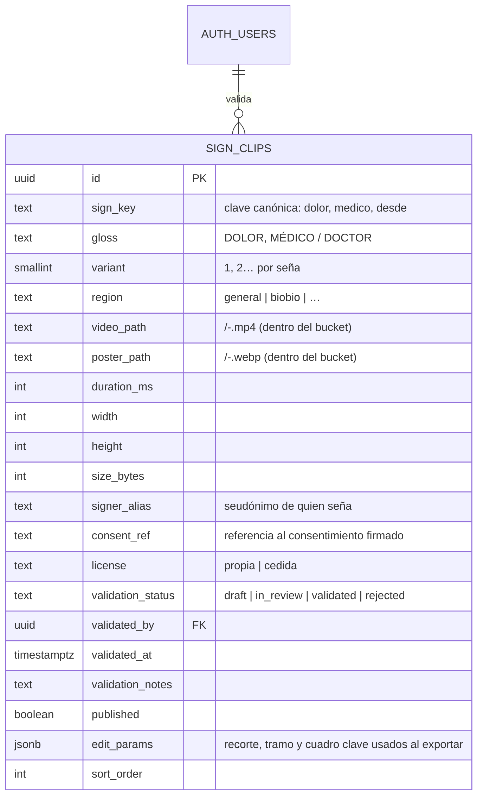
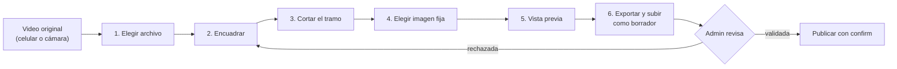

# Señas en video (clips con movimiento)

**Estado:** decisiones aprobadas (sección 9). Fases 2, 3 y 4 implementadas; resultados de QA en la sección 10. Pendiente fuera del repositorio: aplicar la migración en Supabase, generar el dev client con `expo-video` y probar en teléfonos reales (sección 10.3).

**Problema.** `SignImage` muestra fotos fijas. Sirve para el alfabeto estático, pero no para las señas del catálogo sanitario (`docs/ai/catalogo_sanitario_propuesto.md`): DOLOR, AYUDA, DESDE o AYER se definen por su movimiento. Hay que mostrarlas en video dentro de los niveles, el diccionario y los juegos, sin romper tres reglas del proyecto:

1. En la pantalla de una seña nada se mueve solo: la persona decide cuándo se reproduce.
2. Feedback multimodal y `useReducedMotion()`.
3. El contenido se administra desde el panel, sin publicar una versión nueva de la app.

**Fuera de alcance:** grabar los clips (depende de la validación con la comunidad) y el dataset de entrenamiento de la IA (`dynamic_sign_captures`). Los videos de YouTube revisados son solo referencia: no se convierten ni se suben sin permiso escrito de cada canal.

---

## 1. Decisiones de formato

| Decisión | Elegido | Descartado y por qué |
|---|---|---|
| Contenedor | **MP4 H.264**, sin audio | **GIF:** se reproduce solo y en bucle, `Image` no lo pausa, 256 colores manchan la piel y pesa de 5 a 10 veces más. **WebM/AV1:** soporte desigual en iOS. |
| Imagen fija | **WebP** del cuadro clave (la configuración de la mano en su punto más claro), no el primer cuadro | El primer cuadro suele mostrar las manos en reposo y no identifica la seña. |
| Encuadre | **Cuadrado 1:1, 480 × 480**, de la cintura hacia arriba, con codos y cara dentro | Coincide con la caja cuadrada de `SignImage`; la cara es parte de la seña (preguntas y negación). |
| Fotogramas | 30 fps | 60 fps duplica el peso; con 0,5× sigue siendo legible. |
| Duración | De 0,5 a 10 s; se recorta la pausa inicial y final | — (el límite era 6 s; se subió a 10 s para las frases del Club de Talca, ver [11](11-contenido-club-talca.md)) |
| Peso | ≤ 1,5 MB el video (objetivo 300 a 600 KB) y ≤ 150 KB la imagen | Lo exige el bucket; ver la sección 3. |

Estos valores no los elige quien edita: el editor del panel (sección 5) los aplica siempre igual al exportar. Quien edita decide solo el encuadre, el tramo y el cuadro clave.

---

## 2. Modelo de datos

Una tabla propia, `sign_clips`. **No se reutiliza `media`:** `MediaRepository.listVideos()` publica todo `kind = 'video'` en la pestaña Videos, `sign_key` ahí es texto libre sin variantes ni imagen obligatoria, y un clip de seña necesita datos que un video largo no tiene (consentimiento de quien señó, validación lingüística, variante regional).



Restricciones (todas en la migración, no solo en el panel):

- `unique (sign_key, variant)`.
- `check (sign_key ~ '^[a-z0-9ñ~]+(-[a-z0-9ñ~]+)*$')`.
- `check (duration_ms between 500 and 10000)`, `check (size_bytes <= 1500000)` y `check (width = height)`.
- `check (not published or validation_status = 'validated')`: nada sin validar llega a la app.
- Disparador `guard_sign_clip` (`before insert or update`): solo `is_admin()` puede validar, rechazar o publicar; el staff sube borradores, los envía a revisión y puede despublicar. Al validar se rellenan `validated_by = auth.uid()` y `validated_at = now()`. Si cambia el video, la imagen, el encuadre o la clave de un clip validado o rechazado, vuelve a borrador y se despublica. Como `guard_profile_role`, no aplica al SQL Editor ni al service role.
- `edit_params` guarda cómo se exportó el clip: `{ source: { width, height, durationMs }, crop: { left, top, size }, trim: { startMs, endMs }, keyFrameMs }`. Sirve para auditar un clip publicado y para volver a exportarlo con el mismo encuadre si se cambian los parámetros de codificación.
- `consent_ref` es obligatorio. El documento firmado **no** va al bucket público: el video muestra la cara de una persona y es un dato personal. La tabla guarda solo la referencia.

**RLS**

| Operación | Política |
|---|---|
| `select` | `is_staff()`. La app lee la vista `sign_clips_public` (solo publicados, sin datos personales); ver [11](11-contenido-club-talca.md) |
| `insert`, `update` | `is_staff()` (el disparador restringe validar, rechazar y publicar a `is_admin()`) |
| `delete` | `is_admin()` |

**Clave canónica (`sign_key`).** Es la glosa en minúsculas, sin tildes (la ñ se conserva), con guiones entre palabras y sin la parte después de `/`: MÉDICO / DOCTOR → `medico`, SÍ → `si`, DESDE / HACE → `desde`. La genera una función pura `toSignKey(gloss)` en el dominio, que también usarán el panel y los niveles. Es compatible con las claves que existen hoy (`a`…`z`, `ñ`, `n~`), y al quitar las tildes evita que `médico` y `medico` se tomen por señas distintas. Debe coincidir con `sign_class` de la IA pasada a minúsculas, para que un clip y una clase del modelo hablen de la misma seña.

---

## 3. Storage

Bucket nuevo `sign-clips`, separado de `media` para limitarlo a nivel de bucket:

- Público en lectura (los clips publicados se ven sin sesión, igual que el diccionario).
- `file_size_limit = 1.5 MB`, `allowed_mime_types = {video/mp4, image/webp}`.
- Escritura, actualización y borrado: `is_staff()`, igual que `media`.
- Ruta: `<carpeta>/<variant>-<uuid>.<ext>`, donde la carpeta es `toStorageFolder(sign_key)` (`signMedia.js`): Storage solo acepta `[A-Za-z0-9_/!.*'() &$=@;:+,?-]`, así que la ñ pasa a `n_` y `~` a `_` (`mañana` → `man_ana/`). Los `check` de rutas usan la función SQL `public.sign_clip_folder`. El `uuid` evita que la app muestre un clip viejo desde la caché cuando se reemplaza.

La tabla guarda rutas, no URLs: el repositorio arma la URL con `storage.from('sign-clips').getPublicUrl(path)`, que no hace consultas de red. Si cambia el dominio de Supabase, no hay URLs viejas guardadas.

---

## 4. Contratos (app)

### Dominio: `src/features/signs/domain/signMedia.js` (JS puro, con pruebas)

```js
/** @typedef {{ id: string, signKey: string, gloss: string, variant: number, region: string,
 *              videoUrl: string, posterUrl: string, durationMs: number }} SignClip */

/** @typedef {{ kind: 'clip', clip: SignClip, variants: SignClip[] }
 *          | { kind: 'still', sources: number[] }
 *          | { kind: 'placeholder', label: string }} SignMedia */

toSignKey(gloss: string): string
isPlayableClip(row: unknown): row is SignClip          // descarta filas incompletas o con URL no http(s)
groupClipsByKey(clips: SignClip[]): Record<string, SignClip[]>   // ordena por variante
resolveSignMedia({ signKey, clipsByKey, stills }): SignMedia     // prioridad: clip → foto → placeholder
```

`resolveSignMedia` es el único lugar que decide qué se muestra. Así los ejercicios no cambian: cualquier ejercicio con `sign` o `signs` recibe el clip si existe.

### Datos: `src/features/signs/data/SignClipsRepository.js`

```js
createSignClipsRepository({ supabase, storage }) → {
  listClips(): Promise<{ clips: SignClip[], source: 'remote' | 'cache' | 'local' }>,
  getCachedClips(): Promise<{ clips: SignClip[], source: 'cache' } | null>,
}
```

Sigue el patrón `createCachedResource` de `MediaRepository`: lee de Supabase, guarda en caché (`storageKey('signClips', 'v1')`) y, sin red ni caché, devuelve una lista vacía. Nunca lanza errores hacia la UI. Se registra en `core/di/ServicesProvider.js` como `signClips`.

### Presentación

- `SignClipsProvider` + `useSignClips()`: carga la lista una vez por sesión (son unas decenas de filas) y entrega `clipsByKey`, para que `SignImage` resuelva sin esperar.
- Flag `signs.clips` en `DEFAULT_FLAGS` (activado por defecto): permite apagar los clips desde el panel y volver a las fotos si algo falla en producción.

---

## 5. Editor de clips en el panel

Todo el flujo ocurre en el panel: quien sube un video lo encuadra, lo corta en el tiempo, elige la imagen fija y exporta, sin instalar nada. El archivo original nunca sale del computador; al bucket solo llegan el MP4 y la imagen ya procesados.



### 5.1 Pasos

| Paso | Qué hace la persona | Detalles |
|---|---|---|
| 1. Elegir archivo | Arrastra o elige el video (MP4, MOV o WebM, hasta 200 MB) y la glosa del catálogo; la variante se sugiere sola (la siguiente libre). | El archivo se abre en local con `URL.createObjectURL`; no se sube. Los videos verticales del celular se muestran derechos: `mediabunny` respeta la rotación del archivo. |
| 2. Encuadrar | Mueve y escala un **cuadro 1:1** sobre el video. | Encima se dibuja una guía de signado que se puede ocultar: margen sobre la cabeza, línea de cintura y márgenes laterales para los codos. Si el lado del recorte queda bajo 480 px del original, aparece un aviso («se verá borroso»), sin bloquear. El encuadre inicial es el cuadrado más grande centrado. |
| 3. Cortar el tramo | Ajusta inicio y fin en una línea de tiempo con dos tiradores; avanza cuadro a cuadro. | El tramo elegido se repite en bucle en la vista del editor para revisarlo. La duración se valida entre 0,5 y 10 s, con el error junto a la línea de tiempo. |
| 4. Elegir imagen fija | Va al cuadro donde la mano se ve mejor y toca «Usar este cuadro». | Por defecto propone el punto medio del tramo. Muestra una miniatura con el recorte ya aplicado. |
| 5. Vista previa | Ve el clip tal como saldrá en la app: caja de 240 px, imagen fija, 1× / 0,5×. | Usa el mismo recorte en vivo (CSS sobre el `<video>`), sin exportar todavía. |
| 6. Exportar y subir | Toca «Exportar y subir como borrador». | Barra de progreso con texto («Convirtiendo… 45 %», «Subiendo…») y botón Cancelar. Si el MP4 supera 1,5 MB, se reintenta una vez con menor calidad y se avisa; si aún no cabe, se pide acortar el tramo. Termina con un toast y el clip aparece en la lista como borrador. |

Salir del editor con cambios sin exportar pide `confirm`. Validar, rechazar (con nota obligatoria) y publicar también pasan por `confirm`.

### 5.2 Teclado y accesibilidad del editor

- Flechas: mueven el recorte 1 px (con Mayús, 10 px). `+` y `−`: lo agrandan o achican.
- `,` y `.`: retroceden o avanzan un cuadro. `I` y `O`: fijan el inicio y el fin del tramo en el cuadro actual. `K`: usa el cuadro actual como imagen fija.
- El recorte y los tiradores tienen `role="slider"` con valores en texto («Inicio: 0,42 s»), así que se pueden operar sin mouse.
- Los estados (sin clip, borrador, en revisión, validada, publicada) se muestran con icono y texto, no solo con color.

### 5.3 Exportación en el navegador

La hace **`mediabunny`** (versión fija `1.62.1`), con la API `Conversion`:

```ts
const conversion = await Conversion.init({
  input: new Input({ source: new BlobSource(file), formats: ALL_FORMATS }),
  output: new Output({ format: new Mp4OutputFormat({ fastStart: 'in-memory' }), target: new BufferTarget() }),
  trim: { start: edit.trim.startMs / 1000, end: edit.trim.endMs / 1000 },
  video: { crop: toCropRectangle(edit.crop), width: 480, height: 480, frameRate: 30, codec: 'avc', bitrate: QUALITY_MEDIUM },
  audio: { discard: true },
});
```

- Usa WebCodecs, es decir, el codificador de video del propio equipo: no descarga ffmpeg (unos 30 MB en WebAssembly) ni exige cabeceras COOP/COEP en el hosting.
- Se carga con `import()` solo al abrir el editor, así que el resto del panel no paga su peso.
- La imagen fija sale del mismo recorte: se dibuja el cuadro clave en un `canvas` de 480 × 480 y se exporta con `toBlob('image/webp', 0.8)`.
- Antes de abrir el editor se comprueba que el navegador pueda codificar H.264 y exportar WebP (`canEncodeVideo('avc')` y el tipo del blob). Si no puede, el editor no se abre y lo dice: «Este navegador no puede exportar el video; usa Chrome, Edge o Firefox actualizados». Safari no exporta WebP desde `canvas`.
- La licencia es MPL-2.0: se puede usar sin modificar en un proyecto con otra licencia.

### 5.4 Estructura en `web/`

```
web/src/features/admin/content/signClips/
  SignClipsPage.tsx        lista de las 31 glosas con su estado y acciones
  ClipEditor.tsx           los 6 pasos; solo composición, sin lógica de video
  CropOverlay.tsx          cuadro 1:1 movible, guía de signado y teclado
  TrimTimeline.tsx         tiradores de inicio y fin, paso por cuadro
  useClipExport.ts         mediabunny: exporta, informa el progreso y cancela
  clipExport.ts            arma las opciones de Conversion y la imagen fija (sin React)
```

La geometría y las reglas van en el dominio compartido, `src/features/signs/domain/clipEdit.js` (JS puro, reutilizado vía `@domain`, con pruebas): encuadre inicial, mover y escalar el cuadrado sin salirse del video, ajustar tiempos al cuadro más cercano, y `validateClipEdit(edit)`, que devuelve los errores por campo (duración, recorte mínimo, cuadro clave dentro del tramo). El panel y el repositorio de subida usan la misma validación, y la base de datos repite los límites con `check`.

---

## 6. Componente `SignClip` (app)

Reproductor: **`expo-video` (`~57.0.5`)**. Es un módulo nativo, así que exige regenerar el dev client. Ver la sección 9.

```
┌──────────────────────────┐
│ ▣ Con movimiento         │  ← insignia: icono + texto (texto desde 160 px)
│                          │
│   imagen fija (WebP)     │  ← lo que se ve al entrar: nada se mueve
│          ( ▶ )           │  ← botón «Ver la seña…» de 56 px
│                          │
└──────────────────────────┘
     [ Lento ]  [ Repetir ]     ← fuera de la caja: no tapan la mano
```

| Aspecto | Comportamiento implementado |
|---|---|
| Inicio | Muestra la imagen fija. **Nunca se reproduce solo**, tampoco al volver a la pantalla. El video no se descarga hasta el primer toque. |
| Reproducir | Al tocar, reproduce una vez sin audio y vuelve a la imagen fija. Tocar mientras corre lo detiene. |
| Velocidad | Chip «Lento» (0,5×). Es una preferencia del dispositivo, compartida por todos los clips (`useSlowMotion`, `storageKey('signClip.slowMotion', 'v1')`). |
| Repetir | Chip de bucle, apagado por defecto y propio de cada clip. |
| Movimiento reducido | Con `useReducedMotion()` el video se reproduce igual (es el contenido, no un adorno), pero «Repetir» no se ofrece. El cambio imagen-video es instantáneo en todos los casos: el componente no agrega animaciones. |
| Tamaños | **≥ 120 px** (`CLIP_PLAYER_MIN_SIZE`: foco de los ejercicios, quiz, `SignDetailModal`): reproductor. **< 120 px**: solo la imagen fija con un icono de video, así una grilla nunca tiene varios videos a la vez. En `SignStrip`, si alguna seña tiene clip, una sola seña se muestra a 150 px y dos a 120 px, ambas con reproductor; con tres o más (frases), tocar una seña abre su clip en una hoja inferior (`SignClipSheet`). Mantener presionado sigue siendo la pista en todos los casos: en reposo, el área táctil del reproductor es solo el botón de 56 px. Sin clips, `SignStrip` conserva su tamaño de siempre. |
| Accesibilidad | Botón «Ver la seña DOLOR en movimiento» / «Detener la seña DOLOR», pista «Video de 2,8 segundos, sin sonido», `accessibilityState={{ busy }}` al cargar. El nombre es la glosa del clip, no la abreviatura del placeholder. Con caja chica: imagen «Seña de DOLOR, con movimiento». |
| Carga | Indicador dentro del botón de reproducir mientras se descarga. |
| Error | Vuelve a la imagen fija, muestra «No se pudo cargar el video. Toca para reintentar.» (icono y texto), lo anuncia al lector de pantalla y el botón pasa a reintentar. La respuesta del ejercicio nunca queda bloqueada. |
| Sin conexión | `useCaching: true` de `expo-video`: un clip ya visto queda disponible. Precargar los clips del nivel al entrar queda como mejora posterior. |
| Tokens | Solo `theme.*` y `Chip`/`AppText` de `shared/ui`. |

`SignImage` no cambia su API: por dentro llama a `resolveSignMedia` y, si el resultado es `clip`, delega en `SignClip` (o en la imagen fija con insignia, si la caja es chica). Las pantallas que ya usan `SignImage` (ejercicios, diccionario, juegos, progreso) reciben los clips sin cambios.

---

## 7. Niveles

**No hacen falta tipos de ejercicio nuevos.** `word-meaning` («¿Qué significa esta seña?»), `true-false` con `sign` y `recognition` ya reciben claves de seña: basta con que el nivel use `dolor` en vez de una letra. Si después se necesita un ejercicio «mira el video y elige la seña correcta entre imágenes», se agrega con la receta de `senaplay-frontend`.

El editor de niveles del panel avisa, sin bloquear, cuando un ejercicio usa una seña sin clip publicado ni foto («Sin clip publicado ni foto: dolor, tos»), con `missingSignMedia` del dominio. La lista de fotos del dominio (`PHOTO_SIGN_KEYS`) se compara en una prueba con las fotos empaquetadas en la app.

---

## 8. Plan por fases

| Fase | Entregables | Verificación |
|---|---|---|
| **2. Backend y core** | Migración `sign_clips` + bucket + disparador; casos RLS en `supabase/tests/10_rls_policies.sql`; `signMedia.js` (dominio); `SignClipsRepository`; registro en DI; flag `signs.clips`; `clipEdit.js` (geometría y validación del editor) | `pnpm test`, `pnpm test:sql`, `pnpm verify:bundle` |
| **3. Frontend y UX/UI** | `expo-video` + dev client nuevo; `SignClip`; integración en `SignImage` y `SignDetailModal`; editor de clips del panel (`mediabunny`); aviso en el editor de niveles | `pnpm test`, `cd web && pnpm typecheck && pnpm test && pnpm build`, `review-animations`, modo claro y oscuro |
| **4. Testing y QA** | Pruebas del componente con `expo-video` simulado (no se reproduce solo, velocidad, error → imagen fija, movimiento reducido); pruebas del panel (validación del editor, opciones de exportación, permisos por rol); exportar 5 videos reales de celular (verticales y horizontales) y revisar peso y nitidez; prueba en un dispositivo real con red lenta | Toda la verificación de `senaplay-frontend` |

---

## 9. Decisiones (aprobadas el 11-11-2026)

Se aprobaron las seis tal como se proponen; en la 6 se eligió no guardar el video original.

1. **`expo-video` y un dev client nuevo.** La alternativa sin recompilar es reutilizar el `WebView` de `videoPlayerHtml.js`: funciona y admite 0,5×, pero carga una página por clip, no tiene caché offline controlable y en gama baja arranca más lento. Recomiendo `expo-video`.
2. **Tabla `sign_clips` aparte de `media`.** Recomendada por las razones de la sección 2.
3. **Clave sin tildes** (`medico`, `si`). Cambia una regla implícita: hoy `normalizeSignKey` conserva tildes.
4. **Encuadre cuadrado 480 × 480.** Si la persona que graba necesita más espacio lateral (señas con brazos extendidos), la alternativa es 4:5, cambiando la caja de `SignImage` solo para clips.
5. **Editor de clips en el panel con `mediabunny`.** El navegador de quien edita hace la conversión; exige Chrome, Edge o Firefox actualizados. La alternativa, ffmpeg en WebAssembly, funciona en más navegadores pero descarga unos 30 MB y es bastante más lenta.
6. **No guardar el video original.** Con `edit_params` se sabe cómo se exportó cada clip, pero para cambiar el encuadre hay que volver a cargar el original desde el computador. La alternativa es un bucket privado `sign-clips-raw` (solo staff, hasta 200 MB por archivo): permite reeditar desde cualquier equipo, a cambio de guardar más video con la cara de la persona que seña.

---

## 10. QA (Fase 4)

### 10.1 Exportación en el navegador

Exportación real con `mediabunny` en Chromium (Playwright, sin aceleración por hardware) sobre videos generados con ffmpeg para imitar los de un celular. Todas las salidas se revisaron con `ffprobe`: H.264, 480 × 480, 30 fps, sin audio, duración exacta del tramo y `moov` al inicio.

| Video original | Resultado | Tiempo | MP4 |
|---|---|---|---|
| Vertical 1080 × 1920, H.264, 30 fps (Android) | ✓ | 2,0 s | 151 kB |
| Horizontal con metadato de rotación 90° (iPhone «Más compatible») | ✓ se ve vertical, como en el teléfono | 2,3 s | 146 kB |
| HEVC con rotación (iPhone por defecto) | ✕ el navegador no lo decodifica: se avisa al abrirlo, con cómo resolverlo | — | — |
| 4K, 60 fps, 82 MB | ✓ | 18 s | 202 kB |
| Cuadros por segundo variables | ✓ | 0,7 s | 126 kB |
| WebM VP9 | ✓ | 0,9 s | 201 kB |
| 40 s, 78 MB, tramo del medio | ✓ | 3,2 s | 253 kB |
| Cancelar a mitad de la exportación | ✓ se detiene sin error | — | — |

Las mismas pruebas se repitieron sirviendo el editor con la CSP de producción (`web/public/_headers`): todo funciona igual y no hay violaciones. `mediabunny` crea workers desde `blob:` solo para captura en vivo y funciones que el editor no usa, así que no hace falta agregar `worker-src`.

La imagen fija se comparó con el mismo recorte hecho por ffmpeg: coinciden el encuadre y el cuadro. El editor también se revisó en claro, oscuro y a 390 px de ancho (sin scroll horizontal), y el encuadre con teclado.

**HEVC:** Chrome solo lo decodifica si el equipo tiene soporte de hardware (en general Mac y parte de Windows). Recomendación para quien graba: en el iPhone, Ajustes → Cámara → Formatos → «Más compatible».

### 10.2 Errores encontrados y corregidos

- `mediabunny` exige `fit` cuando se fijan ancho y alto: la exportación fallaba siempre. Solo apareció en la prueba con navegador real.
- HEVC daba un mensaje engañoso («usa Chrome») después de editar. Ahora se detecta al abrir el video.
- Con red lenta, si la seña cambiaba durante la descarga, el video anterior se reproducía en la nueva seña.
- En `word-meaning` (el ejercicio principal para estas señas) la seña se mostraba a 72 px: solo la imagen fija, sin forma de ver el clip. Y el reproductor tapaba el gesto de la pista en `SignSpotlight`.

### 10.3 Pendiente en dispositivos reales

No se puede hacer desde el repositorio; requiere el dev client con `expo-video`:

1. Android de gama baja y un iPhone: tocar, 0,5×, repetir, volver a la imagen y el gesto de la pista en el foco del ejercicio.
2. Red lenta (3G en las opciones de desarrollador) y modo avión con un clip ya visto (caché).
3. TalkBack y VoiceOver: nombres, pista del botón, anuncio de error.
4. Exportar 5 videos reales de celular (verticales y horizontales) desde el panel y revisar peso y nitidez.
5. `/review-animations` sobre `SignClip` (solo la puede ejecutar quien usa la sesión).
