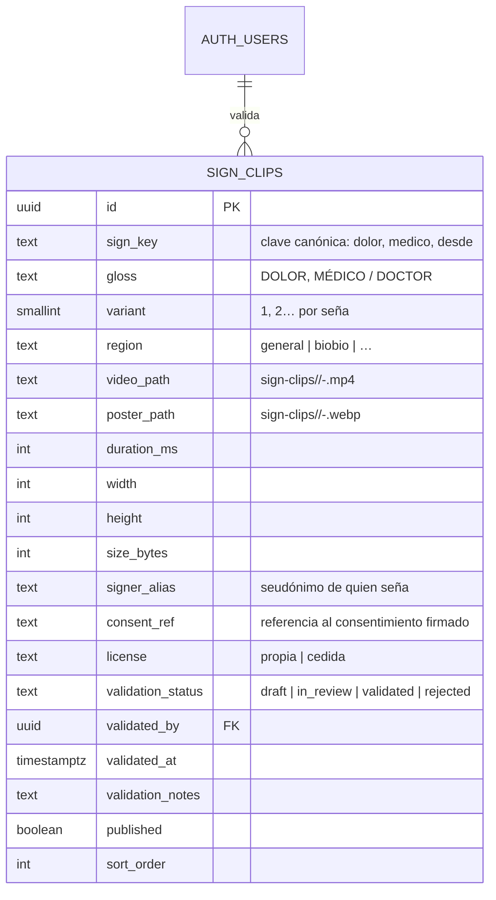
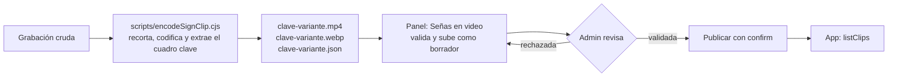

# Señas en video (clips con movimiento)

**Estado:** Fase 1, diseño. Propuesta sin implementar; espera aprobación de las decisiones de la sección 9.

**Problema.** `SignImage` muestra fotos fijas. Sirve para el alfabeto estático, pero no para las señas del catálogo sanitario (`docs/ai/catalogo_sanitario_propuesto.md`): DOLOR, AYUDA, DESDE o AYER se definen por su movimiento. Hay que mostrarlas en video dentro de los niveles, el diccionario y los juegos, sin romper tres reglas del proyecto:

1. En la pantalla de una seña nada se mueve solo: la persona decide cuándo se reproduce.
2. Feedback multimodal y `useReducedMotion()`.
3. El contenido se administra desde el panel, sin publicar una versión nueva de la app.

**Fuera de alcance:** grabar los clips (depende de la validación con la comunidad) y el dataset de entrenamiento de la IA (`dynamic_sign_captures`). Los videos de YouTube revisados son solo referencia: no se convierten ni se suben sin permiso escrito de cada canal.

---

## 1. Decisiones de formato

| Decisión | Elegido | Descartado y por qué |
|---|---|---|
| Contenedor | **MP4 H.264**, `yuv420p`, sin audio, `+faststart` | **GIF:** se reproduce solo y en bucle, `Image` no lo pausa, 256 colores manchan la piel y pesa de 5 a 10 veces más. **WebM/AV1:** soporte desigual en iOS. |
| Imagen fija | **WebP** del cuadro clave (la configuración de la mano en su punto más claro), no el primer cuadro | El primer cuadro suele mostrar las manos en reposo y no identifica la seña. |
| Encuadre | **Cuadrado 1:1, 480 × 480**, de la cintura hacia arriba, con codos y cara dentro | Coincide con la caja cuadrada de `SignImage`; la cara es parte de la seña (preguntas y negación). |
| Fotogramas | 30 fps | 60 fps duplica el peso; con 0,5× sigue siendo legible. |
| Duración | De 0,5 a 6 s; se recorta la pausa inicial y final | — |
| Peso | ≤ 1,5 MB el video (objetivo 300 a 600 KB) y ≤ 150 KB la imagen | Lo exige el bucket; ver la sección 3. |

Parámetros de referencia (los fija el script de la sección 5):

```bash
ffmpeg -ss <inicio> -to <fin> -i <crudo> -vf "crop=<lado>:<lado>:<x>:<y>,scale=480:480,fps=30" -c:v libx264 -profile:v main -crf 26 -preset slow -pix_fmt yuv420p -an -movflags +faststart <clave>-<variante>.mp4
```

```bash
ffmpeg -ss <cuadro_clave> -i <clave>-<variante>.mp4 -frames:v 1 -c:v libwebp -quality 80 <clave>-<variante>.webp
```

---

## 2. Modelo de datos

Una tabla propia, `sign_clips`. **No se reutiliza `media`:** `MediaRepository.listVideos()` publica todo `kind = 'video'` en la pestaña Videos, `sign_key` ahí es texto libre sin variantes ni imagen obligatoria, y un clip de seña necesita datos que un video largo no tiene (consentimiento de quien señó, validación lingüística, variante regional).



Restricciones (todas en la migración, no solo en el panel):

- `unique (sign_key, variant)`.
- `check (sign_key ~ '^[a-z0-9ñ~]+(-[a-z0-9ñ~]+)*$')`.
- `check (duration_ms between 500 and 6000)`, `check (size_bytes <= 1500000)` y `check (width = height)`.
- `check (not published or validation_status = 'validated')`: nada sin validar llega a la app.
- Disparador `before update`: solo `is_admin()` puede pasar a `validated` o `rejected` y publicar; al validar se rellenan `validated_by = auth.uid()` y `validated_at = now()`. El staff sube y edita borradores.
- `consent_ref` es obligatorio. El documento firmado **no** va al bucket público: el video muestra la cara de una persona y es un dato personal. La tabla guarda solo la referencia.

**RLS**

| Operación | Política |
|---|---|
| `select` | `published or is_staff()` |
| `insert`, `update` | `is_staff()` (el disparador restringe validar y publicar a `is_admin()`) |
| `delete` | `is_admin()` |

**Clave canónica (`sign_key`).** Es la glosa en minúsculas, sin tildes (la ñ se conserva), con guiones entre palabras y sin la parte después de `/`: MÉDICO / DOCTOR → `medico`, SÍ → `si`, DESDE / HACE → `desde`. La genera una función pura `toSignKey(gloss)` en el dominio, que también usarán el panel y los niveles. Es compatible con las claves que existen hoy (`a`…`z`, `ñ`, `n~`), y al quitar las tildes evita que `médico` y `medico` se tomen por señas distintas. Debe coincidir con `sign_class` de la IA pasada a minúsculas, para que un clip y una clase del modelo hablen de la misma seña.

---

## 3. Storage

Bucket nuevo `sign-clips`, separado de `media` para limitarlo a nivel de bucket:

- Público en lectura (los clips publicados se ven sin sesión, igual que el diccionario).
- `file_size_limit = 1.5 MB`, `allowed_mime_types = {video/mp4, image/webp}`.
- Escritura, actualización y borrado: `is_staff()`, igual que `media`.
- Ruta: `<sign_key>/<variant>-<uuid>.<ext>`. El `uuid` evita que la app muestre un clip viejo desde la caché cuando se reemplaza.

La tabla guarda rutas, no URLs: el repositorio arma la URL con `storage.from('sign-clips').getPublicUrl(path)`, que no hace consultas de red. Si cambia el dominio de Supabase, no hay URLs viejas guardadas.

---

## 4. Contratos (app)

### Dominio: `src/features/signs/domain/signMedia.js` (JS puro, con pruebas)

```js
/** @typedef {{ id: string, signKey: string, gloss: string, variant: number, region: string,
 *              videoUrl: string, posterUrl: string, durationMs: number }} SignClip */

/** @typedef {{ kind: 'clip', clip: SignClip, variants: SignClip[] }
 *          | { kind: 'still', sources: number[] }
 *          | { kind: 'placeholder', label: string }} SignMedia */

toSignKey(gloss: string): string
isPlayableClip(row: unknown): row is SignClip          // descarta filas incompletas o con URL no http(s)
groupClipsByKey(clips: SignClip[]): Record<string, SignClip[]>   // ordena por variante
resolveSignMedia({ signKey, clipsByKey, stills }): SignMedia     // prioridad: clip → foto → placeholder
```

`resolveSignMedia` es el único lugar que decide qué se muestra. Así los ejercicios no cambian: cualquier ejercicio con `sign` o `signs` recibe el clip si existe.

### Datos: `src/features/signs/data/SignClipsRepository.js`

```js
createSignClipsRepository({ supabase, storage }) → {
  listClips(): Promise<{ clips: SignClip[], source: 'remote' | 'cache' | 'local' }>,
  getCachedClips(): Promise<{ clips: SignClip[], source: 'cache' } | null>,
}
```

Sigue el patrón `createCachedResource` de `MediaRepository`: lee de Supabase, guarda en caché (`storageKey('signClips', 'v1')`) y, sin red ni caché, devuelve una lista vacía. Nunca lanza errores hacia la UI. Se registra en `core/di/ServicesProvider.js` como `signClips`.

### Presentación

- `SignClipsProvider` + `useSignClips()`: carga la lista una vez por sesión (son unas decenas de filas) y entrega `clipsByKey`, para que `SignImage` resuelva sin esperar.
- Flag `signs.clips` en `DEFAULT_FLAGS` (activado por defecto): permite apagar los clips desde el panel y volver a las fotos si algo falla en producción.

---

## 5. Flujo de carga (panel web)



**Script local `scripts/encodeSignClip.cjs`.** Recibe los argumentos `--in`, `--gloss`, `--variant`, `--start`, `--end`, `--key-frame` y `--crop`. Usa el `ffmpeg` y el `ffprobe` del sistema con `execFile`, sin shell, para que una ruta no se pueda interpretar como comando. Escribe el `.mp4`, el `.webp` y un `.json` con duración, tamaño y dimensiones. La construcción de los argumentos de ffmpeg es una función pura con pruebas.

**Codificación en el navegador: descartada para el MVP.** `@ffmpeg/ffmpeg` (ffmpeg compilado a WebAssembly) pesa unos 30 MB, es lento sin hilos (que exigen cabeceras COOP/COEP en el hosting) y lo usaría una sola persona. Se puede retomar si el equipo de grabación crece.

**Página `web/src/features/admin/content/SignClipsPage.tsx`:**

- Muestra las 31 glosas del catálogo como lista de avance, con estado sin clip, borrador, en revisión, validada o publicada. El estado se indica con icono y texto, no solo con color.
- Al subir, valida en el navegador antes de enviar: tipo MIME, peso, que el video sea cuadrado y dure de 0,5 a 6 s (leído con `HTMLVideoElement.loadedmetadata`), que haya imagen fija y que `consent_ref` no esté vacío. Los errores aparecen junto a cada campo.
- Validar, rechazar (con nota obligatoria) y publicar pasan por `useFeedback().confirm`. Despublicar es inmediato y revierte con un toque.
- Los tipos (`SignClipRow`, `SignClipStatus`) van en `web/src/lib/domain.ts`. `toSignKey` se reutiliza a través del alias `@domain`.

---

## 6. Componente `SignClip` (app)

Reproductor: **`expo-video` (`~57.0.5`)**. Es un módulo nativo, así que exige regenerar el dev client. Ver la sección 9.

```
┌──────────────────────────┐
│                          │
│   imagen fija (WebP)     │  ← lo que se ve al entrar: nada se mueve
│         ▶                │  ← botón «Ver seña» (≥ 44 px)
│                          │
│ ⟳ con movimiento         │  ← insignia: icono + texto
└──────────────────────────┘
  [ 1× | 0,5× ]   [ ⟲ Repetir ]
```

| Aspecto | Comportamiento |
|---|---|
| Inicio | Muestra la imagen fija. **Nunca se reproduce solo**, tampoco al volver a la pantalla. |
| Reproducir | Al tocar, reproduce una vez sin audio y vuelve a la imagen fija. |
| Velocidad | `SegmentedControl` 1× / 0,5×. La preferencia se guarda con `jsonStorage` (`storageKey('signClip', 'v1', userId)`). |
| Repetir | Interruptor de bucle, apagado por defecto. Se apaga al salir de la seña. |
| Movimiento reducido | Con `useReducedMotion()` se reproduce igual (el video es el contenido, no decoración), pero el bucle no se ofrece y la transición imagen-video es instantánea. |
| Tamaños | **≥ 160 px** (enunciado del ejercicio, `SignDetailModal`): reproductor completo. **< 160 px** (fichas de emparejar, memoria, `SignStrip`): solo la imagen fija y la insignia; mantener presionado (el mismo gesto de la pista en `OptionTile`) abre el reproductor en un diálogo. Así nunca hay varios videos a la vez en una grilla. |
| Accesibilidad | `accessibilityRole="button"`, etiqueta «Seña DOLOR, video de 3 segundos», `accessibilityState={{ busy }}` mientras carga, y `announce('Reproduciendo seña DOLOR')`. La descripción textual (`how_to`) se ofrece como alternativa. |
| Carga | Skeleton del tamaño de la caja; sin spinner sin texto. |
| Error | Vuelve a la imagen fija con aviso «No se pudo cargar el video» y botón «Reintentar». Sin imagen fija, muestra el placeholder actual. La respuesta del ejercicio nunca queda bloqueada. |
| Sin conexión | `useCaching: true` de `expo-video`: un clip ya visto queda disponible. Precargar los clips del nivel al entrar queda como mejora posterior. |
| Tokens | Solo `theme.*`; insignia y controles con componentes de `shared/ui`. Revisar en modo claro y oscuro. |

`SignImage` no cambia su API: por dentro llama a `resolveSignMedia` y, si el resultado es `clip`, delega en `SignClip` (o en la imagen fija con insignia, si la caja es chica). Las pantallas que ya usan `SignImage` (ejercicios, diccionario, juegos, progreso) reciben los clips sin cambios.

---

## 7. Niveles

**No hacen falta tipos de ejercicio nuevos.** `word-meaning` («¿Qué significa esta seña?»), `true-false` con `sign` y `recognition` ya reciben claves de seña: basta con que el nivel use `dolor` en vez de una letra. Si después se necesita un ejercicio «mira el video y elige la seña correcta entre imágenes», se agrega con la receta de `senaplay-frontend`.

El editor de niveles del panel debería avisar cuando un ejercicio usa una clave sin clip publicado ni foto: es un aviso, no un bloqueo, porque se muestra el placeholder.

---

## 8. Plan por fases

| Fase | Entregables | Verificación |
|---|---|---|
| **2. Backend y core** | Migración `sign_clips` + bucket + disparador; casos RLS en `supabase/tests/10_rls_policies.sql`; `signMedia.js` (dominio); `SignClipsRepository`; registro en DI; flag `signs.clips`; `scripts/encodeSignClip.cjs` | `pnpm test`, `pnpm test:sql`, `pnpm verify:bundle` |
| **3. Frontend y UX/UI** | `expo-video` + dev client nuevo; `SignClip`; integración en `SignImage` y `SignDetailModal`; página del panel; aviso en el editor de niveles | `pnpm test`, `cd web && pnpm typecheck && pnpm test && pnpm build`, `review-animations`, modo claro y oscuro |
| **4. Testing y QA** | Pruebas del componente con `expo-video` simulado (no se reproduce solo, velocidad, error → imagen fija, movimiento reducido); pruebas del panel (validación de archivo, permisos por rol); prueba en un dispositivo real con red lenta | Toda la verificación de `senaplay-frontend` |

---

## 9. Decisiones que necesitan aprobación

1. **`expo-video` y un dev client nuevo.** La alternativa sin recompilar es reutilizar el `WebView` de `videoPlayerHtml.js`: funciona y admite 0,5×, pero carga una página por clip, no tiene caché offline controlable y en gama baja arranca más lento. Recomiendo `expo-video`.
2. **Tabla `sign_clips` aparte de `media`.** Recomendada por las razones de la sección 2.
3. **Clave sin tildes** (`medico`, `si`). Cambia una regla implícita: hoy `normalizeSignKey` conserva tildes.
4. **Encuadre cuadrado 480 × 480.** Si la persona que graba necesita más espacio lateral (señas con brazos extendidos), la alternativa es 4:5, cambiando la caja de `SignImage` solo para clips.
5. **Codificación con un script local** en vez de hacerlo en el navegador del panel.
