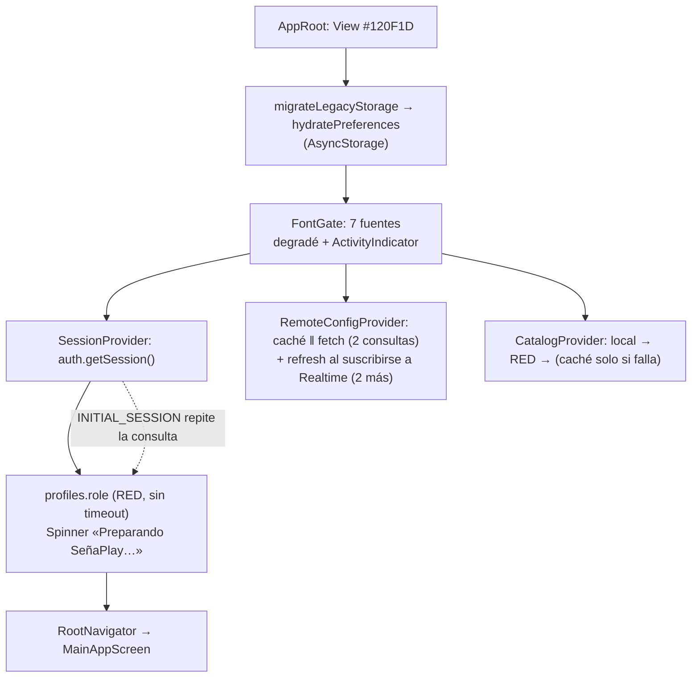

# Auditoría de pulido: app móvil (Fase 1)

> Diagnóstico de solo lectura: no toca `src/`. Revisado sobre `gestilingo-dev` @ `ec63ed8`.
> Fuentes: `CLAUDE.md` (precedencia), skills `senaplay-frontend` y `senaplay-ui`, `docs/01`, `02` §2.4, `06` y `07`, y el criterio de `improve-animations`, `find-animation-opportunities`, `review-animations`, `animate-expo`, `emil-design-eng` y `apple-design`, aplicado con `Animated` y el driver nativo.

## Resumen

| Frente | Hallazgos | Altos | Lo más rentable |
|---|---|---|---|
| A · Datos/Supabase | 11 | 6 | Rol en caché y con timeout (A1); caché primero en catálogo, diccionario y videos (A3, A5, A6); timeout de lectura (A7) |
| B · Animaciones | 12 | 2 | `useReducedMotion` síncrono y global (B1); diálogos que se vacían al cerrarse (B2) |
| C · UX/UI | 8 | 2 | Scroll heredado entre pestañas (C1); controles sin rol ni label en las pantallas de cámara (C2) |

El movimiento de la app ya está cerca de lo correcto: usa tokens, driver nativo y reducir movimiento en casi todos los componentes. Los problemas más visibles son de **datos**: el arranque espera una consulta de red sin límite de tiempo y tres pantallas ignoran su caché cuando hay conexión.

**Línea base de tests** (`pnpm test` en este contenedor): con workers en paralelo fallan 4 de 112 tests de 3 suites por *timeout* de 5 s en el primer test de cada una. En serie (`--runInBand`) esas mismas suites pasan (14/14). Jest además avisa que un worker no terminó limpio (timers abiertos). Se aborda en la Fase 4.

## A · Carga de datos desde Supabase

### Cascada de arranque actual (verificada)

- Secuencial sin necesidad: las **fuentes esperan** a la migración de AsyncStorage (B → C), aunque no dependen de ella.
- Bloquea la UI: **E**. Cada arranque en frío con sesión guardada espera `profiles.role` por red antes de mostrar nada.
- Consultas repetidas: el rol (×2 al arrancar), la config remota (×2 al arrancar y luego cada 30 s aunque Realtime esté conectado), el diccionario (2 tablas) y los videos en **cada** entrada a su pestaña, porque cada pestaña se desmonta al salir (`FadeInView key`).
- Columnas de más: no hay casos relevantes. Cada `select` pide lo que la pantalla usa.

### Hipótesis del encargo

| Hipótesis | Veredicto |
|---|---|
| `getLevels()` va primero a la red y la caché solo se usa si falla | **Confirmada** (`CatalogRepository.js:57-75`). Con conexión, quien vuelve ve el catálogo empaquetado y luego el remoto; su caché nunca se muestra. |
| `VideosTabScreen` vuelve a llamar `listVideos()` al montarse | **Confirmada**, y pasa lo mismo con el Diccionario, que además oculta los datos locales tras el skeleton. |
| El spinner «Preparando SeñaPlay…» espera la sesión completa | **Confirmada**: espera `profiles.role` por red. Se puede eliminar sin romper el gate de admins (A1). |
| Timeouts y red lenta | **Ninguna lectura tiene timeout** (solo `signCamera.js` usa `AbortController`). Con red lenta, el spinner y los skeletons duran lo que tarde el `fetch`. |

### Hallazgos A

| # | Hallazgo | Archivo:línea | ID | Impacto | Esfuerzo | Riesgo | Propuesta |
|---|---|---|---|---|---|---|---|
| A1 | El arranque en frío espera `profiles.role` por red, sin caché persistente ni timeout. | `auth/presentation/SessionProvider.js:40` · `profile/data/SupabaseProfileRepository.js:26` | RA-02, FB-03 | Alto | S | Medio | Guardar el rol por usuario (`storageKey('role','v1',userId)`) dentro del repositorio: `getCachedRole(userId)` instantáneo y `getRole()` que guarda. `SessionProvider` usa la caché si existe y revalida en segundo plano (esa rama ya existe para los refrescos de token). Solo el **primer** inicio en el dispositivo espera la red, con timeout (A7). Mantiene el fix `183308f`: un admin con caché entra como admin desde el primer frame. |
| A2 | Rol pedido dos veces al arrancar: `getSession()` y el evento `INITIAL_SESSION` de `onAuthStateChange` llaman `applySession` en paralelo y ninguno ve la caché del otro. | `SessionProvider.js:64-69` | RA-02 | Medio | S | Bajo | Reutilizar la promesa en vuelo por `userId` (memo de la consulta en curso). El `ticket` actual sigue resolviendo la carrera de estado. |
| A3 | Catálogo con la red primero: con conexión la caché nunca se usa; `local → remoto` puede cambiar el contenido visible un instante después de abrir. | `levels/data/CatalogRepository.js:57-75` · `levels/presentation/CatalogContext.js:33` | RA-02 | Alto | M | Bajo | Stale-while-revalidate: agregar `getCachedLevels()` → `{ levels, source: 'cache', warnings } \| null`. El provider pinta **local → caché (al instante) → remoto**, y solo hace `setLevels` si las filas crudas cambiaron (comparar firma JSON, como ya hace `RemoteConfigProvider`). `getLevels()` conserva su contrato. Tests: orden de fuentes, caché inválida → local, sin red, red lenta y una sola llamada remota. |
| A4 | Si el catálogo remoto llega con un nivel abierto, `getLevelById` entrega otro objeto y `LevelSessionScreen` vuelve a sortear los ejercicios en plena sesión. | `app/MainAppScreen.js:174` · `levels/presentation/LevelSessionScreen.js:54-58` | RA-04 | Alto | S | Bajo | Congelar el nivel al abrirlo (guardar el objeto en el estado de `MainAppScreen` en vez de buscarlo por id en cada render). Test: reemplazar el catálogo con la sesión abierta no cambia el ejercicio actual. |
| A5 | Diccionario: cada entrada a la pestaña hace 2 consultas, espera la red y **oculta los datos locales** detrás del skeleton. | `dictionary/presentation/DictionaryTabScreen.js:136,210,237,247` · `signs/data/SignsRepository.js:14-27` | RA-02, FB-03 | Alto | M | Bajo | El mismo SWR de A3 en `withFallback`: `getCached*()` instantáneo y revalidación remota como máximo una vez por sesión (memo en memoria del repositorio con TTL, p. ej. 5 min). La pantalla muestra lo local o la caché desde el primer frame; skeleton solo si no hay nada. |
| A6 | Videos: refetch y skeleton en cada visita. | `videos/presentation/VideosTabScreen.js:45` · `videos/data/MediaRepository.js:33` | RA-02, FB-03 | Medio | S | Bajo | El mismo helper de A5 (`getCachedVideos()` + memo con TTL). |
| A7 | Ninguna lectura de Supabase tiene timeout: con red lenta el spinner o el skeleton no tienen tope. | todos los `features/*/data` | RA-02, FB-02 | Alto | M | Medio | Helper en `core/` (`withTimeout(builder, ms)`) que usa `.abortSignal()` de PostgREST con `AbortController` + `setTimeout` (no depender de `AbortSignal.timeout` en Hermes). 8 s para lecturas y 4 s para el rol en el primer inicio; al vencer cae a caché/local como cualquier error. **No** aplicarlo globalmente en `client.js`: el refresco de token y la subida de avatar necesitan más tiempo. |
| A8 | Config remota: sondeo cada 30 s aun con Realtime suscrito (2 consultas/30 s por usuario activo ≈ 240/h) y doble `fetch` al arrancar (montaje + `SUBSCRIBED`). | `remoteConfig/presentation/RemoteConfigProvider.js:72,81` · `remoteConfig/data/RemoteConfigRepository.js:69` | RA-02, PW-04 | Medio | S | Medio | Sondear solo mientras el canal **no** esté `SUBSCRIBED` (el repositorio informa el estado) e ignorar el refresh de `SUBSCRIBED` si el último fetch fue hace menos de `FOREGROUND_THROTTLE_MS`. Toca una decisión documentada (`a666e73`): ver «Requiere decisión». |
| A9 | Carrera: si la red responde antes que AsyncStorage, `getCached().then` pisa la config fresca con la vieja. | `RemoteConfigProvider.js:65-70` | RA-02 | Bajo | S | Bajo | `setSnapshot((prev) => prev ?? cached)`. |
| A10 | Arranque en serie con tres pantallas de carga distintas (`#120F1D` → degradé + `ActivityIndicator` → `Spinner`); `expo-splash-screen` está instalado pero no se usa. | `app/AppRoot.js:47-53,70-76,99` · `app/RootNavigator.js:42-48` | FB-02, MX-04, DS-03 | Medio | M | Bajo | Cargar fuentes **en paralelo** con la migración, mantener el splash nativo (`preventAutoHideAsync`/`hideAsync`, API JS de un módulo ya instalado, sin rebuild) hasta tener fuentes + almacenamiento, y mostrar después un solo `Spinner` con texto. Reemplaza el hex suelto por el token del tema oscuro importado estáticamente. |
| A11 | `reload()` del catálogo no tiene llamadores (código muerto). | `CatalogContext.js:20-29` | RA-02 | Bajo | S | Bajo | Eliminarlo, o reutilizar su cuerpo como el «revalidar» de A3. |

## B · Animaciones

### Inventario de lo existente

| Componente | Driver nativo | Reducir movimiento | Tokens `theme.motion` | Interrumpible | Comunica |
|---|---|---|---|---|---|
| `FadeInView` / `StaggerItem` | Sí | **Parcial** (B1) | Duración por prop (220) y curva literal igual a `enter` | Sí (se remonta) | Sí: cambio de destino |
| `AppBottomNav` | Sí | Sí | `spring.pop` | Sí (spring) | Sí: pestaña activa (rebote de más, B8) |
| `Dialog` | Sí | Sí | `base` + `pop` | — | Sí, pero se vacía al cerrarse (B2) |
| `BottomSheet` | Sí | Sí | `slow` + `enter` | — | Entra, pero sale sin deslizar (B7) |
| `Toast` | Sí | Sí | `base`/`fast`; salida sin curva | Reinicia desde 0 (B11) | Sí |
| `Skeleton` | Sí | Sí | Literales 650 ms | — | Sí: carga (un loop por bloque, B10) |
| `Spinner` | Sí | Sí (cae al del sistema) | Literales (lineal en el giro, correcto) | — | Sí |
| `BlockingOverlay` | Sí | **No** (B3) | `base` + `pop` | — | Sí |
| `Button` | Sí (spring) | Sí | `spring.press` | Sí | Sí: presión |
| `ProgressBar` | Sí (`translateX`) | Sí | `emphasis` + `enter` | Sí | Sí: avance |
| `ThemeToggle` | Sí | Sí | `base` + `standard` | Sí | Sí |
| `FeedbackPanel` | Sí | Sí | `base` + `pop` (B5) · halo 900 literal | — | Sí; duplica el halo (B4) |
| Halo de la tarjeta (`LevelSessionScreen`) | Sí | Sí | 1100 literal, sin curva | — | Duplica el anterior (B4) |
| `LivesCounter` | Sí | Sí | `emphasis` + `exit` + `shake(6)` | Reinicia con `setValue` | Sí: vida perdida, no punitiva |
| `HintPopover` | Sí | Sí | `base` + `pop` | — | Sí; escala desde el centro y sin salida (B12) |
| `Confetti` | Sí | Sí, pero puede asomar 1 frame (B1) | 2400 literal (celebración, aceptable) | — | Deleite (raro) |
| `LevelCompleteCelebration` | Sí | Sí | `slow` + `pop`, estrellas desde escala 0 (B6) | — | Deleite (raro) |
| `SignImage` (variaciones) | Sí | No aplica (solo opacidad) | 160 literal = `fast` | **No** (B9) | Sí: cambio de variación pedido por la persona |

### Hallazgos B

| # | Hallazgo | Archivo:línea | ID | Impacto | Esfuerzo | Riesgo | Propuesta (valores exactos) |
|---|---|---|---|---|---|---|---|
| B1 | `useReducedMotion` parte en `false` y se resuelve async **por instancia**. `FadeInView` fija su animación al montar (`[]`), así que con «reducir movimiento» activo cada cambio de pestaña y cada `StaggerItem` igual corre 220 ms con delays de hasta 360 ms. `Confetti` puede asomar. Además hay un listener de `AccessibilityInfo` por cada `Button`, `Skeleton`, etc. | `core/a11y/useReducedMotion.js:8-27` · `shared/ui/motion/FadeInView.js:19-29` · `levels/presentation/session/Confetti.js:43` | MX-09 | Alto | S | Bajo | Store de módulo con **un** listener y `useSyncExternalStore`, cebado en el arranque (`Promise.all` junto a `migrateLegacyStorage`). Así el valor ya es correcto en el primer render de cualquier componente. La API del hook no cambia. Test: con el valor cebado en `true`, `FadeInView` usa 120 ms, sin delay ni desplazamiento. |
| B2 | Al resolver `confirm()`/`showMessage()` el estado pasa a `null` mientras el `Modal` todavía se desvanece: el diálogo pierde título y mensaje y cambia a tono `warning` y botón `primary` durante la salida (~200-300 ms). Pasa en **cada** confirmación. | `shared/ui/feedback/FeedbackProvider.js:43,60,127-144` · `ConfirmDialog.js:23` | FB-01, MX-04 | Alto | S | Bajo | Guardar el último estado no nulo en una ref y renderizar con él mientras `visible` es `false`. Test: tras confirmar, el título sigue en el árbol hasta desmontar. Revisar en dispositivo a cámara lenta. |
| B3 | `BlockingOverlay` hace pop con rebote sin respetar reducir movimiento. | `shared/ui/feedback/BlockingOverlay.js:20-33` | MX-09 | Medio | S | Bajo | Con `reduced`: `scale.setValue(1)` y opacidad en `instant` (110 ms). |
| B4 | Doble halo en cada respuesta: el de la tarjeta (1100 ms) y el de `FeedbackPanel` (900 ms), con duraciones sueltas, sin curva y dos sombras con `elevation` animadas. | `levels/presentation/LevelSessionScreen.js:75-85,174-177` · `session/FeedbackPanel.js:28-37,59` | MX-01, DS-04 | Medio | S | Bajo | Dejar **un** halo, el de la tarjeta, que marca el ejercicio: `1 → 0.4`, `duration: theme.motion.duration.celebration` (900), `easing: theme.motion.easing.enter`. El panel ya tiene borde, color, icono y texto. |
| B5 | `FeedbackPanel` entra con `easing.pop` (rebote) en cada respuesta, decenas de veces por sesión. | `session/FeedbackPanel.js:29-34` | MX-01 | Medio | S | Bajo | `duration.base` (220) + `easing.enter`, `translateY 16 → 0`. Reservar `pop` para eventos raros. |
| B6 | Las estrellas de la celebración escalan desde 0 («nada aparece de la nada»). | `session/LevelCompleteCelebration.js:13-23` | MX-06 | Bajo | S | Bajo | `scale: pop.interpolate([0,1] → [0.6,1])` y `opacity: pop`; se mantienen el `spring.pop` y los delays `420 + i·160`. |
| B7 | `BottomSheet`: sube desde un desplazamiento fijo de 400 px (una hoja de hasta 88 % de alto puede empezar parcialmente visible), sale sin deslizar (solo el fade del `Modal`) y usa la curva genérica. | `shared/ui/feedback/BottomSheet.js:21-32,48` | MX-04, DS-01 | Medio | M | Medio | Medir la altura con `onLayout` y partir desde ella. Nuevo token `motion.easing.drawer = Easing.bezier(0.32, 0.72, 0, 1)`: entrada `slow` (320) con `drawer` y salida `base` (220) con `exit` **antes** de llamar `onClose` (estado interno de montaje). Con reducir movimiento, solo fade de 110 ms. |
| B8 | La barra inferior usa `spring.pop` (con rebote) en la navegación principal, decenas de veces al día. | `app/navigation/AppBottomNav.js:19-27` | MX-04 | Bajo | S | Bajo | `spring.press` (`friction 7, tension 220`): mismo gesto, sin oscilación. |
| B9 | Las variaciones de `SignImage` no son interrumpibles: dos toques rápidos calculan el índice con el valor viejo y el callback corre aunque la animación se haya cortado. Además baja a opacidad 0 (imagen en blanco) entre variaciones. | `signs/presentation/SignImage.js:55-71` | MX-04 | Medio | S | Bajo | `indexRef` para el próximo índice y `.stop()` de la animación previa. Salida `fast` (160) con `exit` hasta 0.15, no 0; cambio de fuente; entrada `fast` con `enter`. Con reducir movimiento, cambio directo. Respeta «nada se mueve solo»: lo dispara la persona. |
| B10 | `Skeleton`: un `Animated.loop` y un listener por bloque (12 en una `SkeletonList` de 4). | `shared/ui/loading/Skeleton.js:19-29` | FB-03 | Bajo | M | Bajo | Un valor compartido por `SkeletonList` vía contexto (pulso único y sincronizado); `Skeleton` suelto conserva su loop. |
| B11 | `Toast`: la salida no tiene curva y un toast nuevo reinicia desde 0 (salto si ya había uno visible). | `shared/ui/feedback/Toast.js:24-38` | MX-01 | Bajo | S | Bajo | Salida `fast` + `easing.exit`; si ya hay uno visible, reemplazar el contenido sin `setValue(0)`. |
| B12 | `HintPopover` escala desde su centro aunque nace de la ampolleta (abajo a la derecha) y se cierra sin salida. | `levels/presentation/session/HintFab.js:44-70` | MX-08 | Bajo | S | Bajo | Origen simulado con traslación (`translateX 12→0`, `translateY 12→0`, `scale 0.94→1`), `base` + `enter`. Revisar en dispositivo antes de decidir `transformOrigin` (Android con driver nativo ya falló en `ProgressBar`). |

### Oportunidades (pasaron el filtro de `find-animation-opportunities`)

| # | Lugar | Hoy | Propósito | Frecuencia | Movimiento sugerido |
|---|---|---|---|---|---|
| O1 | `LevelSessionScreen.js:161` (cambio de ejercicio) | El contenido se reemplaza de golpe al tocar «Continuar». | Evitar un cambio brusco | Decenas por sesión | `FadeInView key={exerciseKey} distance={0} duration={theme.motion.duration.fast}`: **solo opacidad**, 160 ms con `enter`, porque lo dispara la persona. Nada se desplaza bajo la seña. Con reducir movimiento, 110 ms. (MX-04) |

### Candidatos descartados

- **Animar la presión de `OptionTile`, `Card`, `Chip` o `IconButton`:** ya tienen feedback instantáneo por estilo y son de altísima frecuencia. Animarlos los haría sentir lentos.
- **Transición skeleton → contenido:** el contenido ya entra con `FadeInView`; otro fade solo agrega espera.
- **Animar el reemplazo del catálogo remoto (A3):** es información que la persona está leyendo. Con SWR el cambio desaparece casi siempre, que es mejor que animarlo.
- **Carrusel automático en `SignImage` o «respiración» en la seña:** prohibido; en la pantalla de una seña nada se mueve solo.
- **Animar el camino de niveles al completar uno:** decoración sobre una lista funcional que se ve a diario. La celebración ya cubre ese momento.

**Veredicto.** No hace falta más movimiento: hace falta que el existente respete siempre «reducir movimiento» (B1, B3), no muestre estados rotos (B2) y tenga menos rebote en lo frecuente (B5, B8). Lo de mayor palanca es **B1**. Nada de esto requiere Reanimated ni Gesture Handler.

## C · UX/UI

| # | Hallazgo | Archivo:línea | ID | Impacto | Esfuerzo | Riesgo | Propuesta |
|---|---|---|---|---|---|---|---|
| C1 | Un solo `ScrollView` para Niveles, Videos, Juegos, Progreso y Perfil, y `onChangeTab={setActiveTab}` no vuelve al inicio: la pestaña nueva se abre con el scroll de la anterior. | `app/MainAppScreen.js:283,295` | MX-04 | Alto | S | Bajo | `handleChangeTab` que hace `scrollTo({ y: 0, animated: false })` antes de cambiar. Sin animación, porque es un cambio de contexto. |
| C2 | Las pantallas de cámara están fuera del design system: `TouchableOpacity` sin `accessibilityRole` ni label (el lector lee «‹», «›», «⏸ Pausar»), toggles sin `accessibilityState` y `fontWeight` sin familia. | `camera/presentation/SignPracticeScreen.js:107,148,169,189-229` · `CameraTranslationScreen.js:180-195` · `signCamera.js:270,375,389` · `DynamicSignMonitorScreen.js:67` · `SpellingGameScreen.js:136,146` | MX-02, MX-03 | Alto | S (a11y) / M (tipografía) | Bajo | **Fase 3a (S):** `accessibilityRole`, labels en español («Seña anterior», «Pausar traducción»…), `accessibilityState` en toggles y `busy` al grabar, sin cambio visual. **Fase 3b (M):** `typography.*` con `cameraColors` en lugar de `fontWeight` suelto. Sin animaciones nuevas: el hilo JS ya va cargado. |
| C3 | Etiquetas de la barra inferior a 11 px que pueden encogerse hasta ≈ 8 px (`minimumFontScale 0.72`). | `app/navigation/AppBottomNav.js:53-56,101-109` | MX-03 | Medio | S | Medio | Subir `minimumFontScale` a 0.9 y medir en 360 dp con escala de fuente 1.3. Cambia el layout de 5 pestañas: ver «Requiere decisión». |
| C4 | Las flechas de variación de `SignImage` quedan bajo 44 px en tamaños chicos (`flechaCaja` 18-23 + `hitSlop` 8). | `signs/presentation/SignImage.js:75-76,97,107` | MX-02 | Medio | S | Medio | `hitSlop` calculado hasta `theme.minTouch`. Probar en la grilla de emparejar para que no invada casillas vecinas. |
| C5 | Radios fuera de la escala documentada: `Dialog` y la celebración usan `xxl` (24; el doc dice diálogos = `xl` 20) y `BottomSheet` usa `xxl + 4` (28). | `feedback/Dialog.js:117` · `feedback/BottomSheet.js:77-78` · `session/LevelCompleteCelebration.js:129` | DS-02 | Bajo | S | Bajo | Alinear código y doc. Es un cambio visual: ver «Requiere decisión». |
| C6 | `fontWeight: '900'` sin familia en el placeholder de `SignImage` (Android no sintetiza pesos). | `signs/presentation/SignImage.js:204` | MX-03 | Bajo | S | Bajo | `fontFamily: APP_FONTS.black`. |
| C7 | `BottomSheet`: el fondo presionable no tiene rol, y el asa sugiere arrastrar pero no arrastra. | `feedback/BottomSheet.js:42,51` | MX-02 | Bajo | S | Bajo | `accessibilityRole="button"` en el fondo. El asa queda decorativa (oculta al lector); el arrastre va en «Requiere decisión». |
| C8 | Hex suelto `#120F1D` en el arranque. | `app/AppRoot.js:99` | DS-03 | Bajo | S | Bajo | Se resuelve en A10. |

## Fuera de alcance / requiere decisión

1. **A8, intervalo de sondeo:** cambia el comportamiento de `a666e73` («se aplica en segundos»). Propuesta: Realtime como vía principal y sondeo de 30 s solo con el canal caído. ¿Aprobado?
2. **C3, etiquetas de la barra inferior:** subir el mínimo legible puede obligar a acortar textos («Diccionario» → «Señas») o a ocultar etiquetas inactivas. Hay que elegir.
3. **C5, radios:** ¿se alinea el código al doc (`xl` 20 en diálogos) o el doc al código (`xxl` 24)?
4. **Arrastrar para cerrar el `BottomSheet`:** se puede con `PanResponder` (núcleo de RN, sin dependencias), pero es una interacción nueva. Queda fuera salvo aprobación.
5. **Índices SQL:** no aportan. `exercises` ya tiene `unique (level_id, position)`, `media` ya tiene `idx_media_kind_published`, y `levels`, `dictionary` y `signs` son tablas chicas. El cuello de botella es la red y la falta de caché, no Postgres. No se propone migración.
6. **Dependencias:** ninguna nueva. Reanimated, Gesture Handler y `expo-image` no hacen falta para nada de lo anterior. `@react-navigation/native` y `native-stack` están en `package.json` sin uso en `src/`: retirarlas es una decisión aparte.
7. **Fase 4, estabilidad de Jest:** `testTimeout` ≥ 15 s en `package.json` y cerrar los timers que dejan un worker colgado (`--detectOpenHandles`). No cambia la app; es para que la verificación obligatoria sea confiable.

## Plan propuesto (para aprobar)

| Fase | Paquete | Hallazgos | Commits estimados |
|---|---|---|---|
| 2a | Arranque sin espera | A1, A2, A7 (helper + rol), A10, C8 | 3 |
| 2b | Caché primero | A3, A4, A5, A6, A9, A11 (+ A7 en esos repositorios) | 3 |
| 2c | Config remota | A8 (si se aprueba) | 1 |
| 3a | Movimiento correcto | B1, B2, B3, B4, B5, B8, B9, O1 | 3 |
| 3b | Pulido | B6, B7, B10, B11, B12, C1, C2, C4, C6, C7 (+ C3 y C5 según decisión) | 3-4 |
| 4 | QA | Jest estable, `pnpm test`, `pnpm verify:bundle`, `checkMermaid`, `docs/06` y `docs/02` §2.4 | 1-2 |

Orden sugerido si hay que recortar: **A1 → B1 → B2 → A3/A5 → C1 → A7 → A4**.
