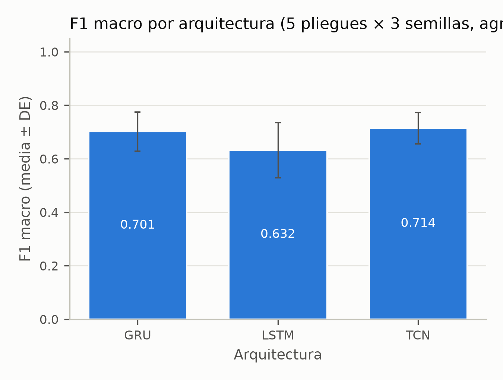

# Resumen de resultados

Generado el 2026-11-19 15:47. Métricas en porcentaje, media ± desviación estándar sobre pliegues × semillas. Latencia en CPU, batch 1, una ventana de T frames (media y percentil 95).

## Señas dinámicas · experimento `comparacion_temporal` · validación `kfold`

| Arquitectura | Parámetros | Accuracy | Precisión macro | Recall macro | F1 macro | Latencia media (ms) | Latencia p95 (ms) | Tamaño (MB) |
|---|---:|---:|---:|---:|---:|---:|---:|---:|
| GRU | 227342 | 70.3 ± 7.4 | 74.1 ± 7.8 | 71.5 ± 6.3 | 70.1 ± 7.3 | 3.91 | 4.00 | 0.87 |
| LSTM | 268814 | 63.9 ± 10.0 | 68.2 ± 10.4 | 65.1 ± 9.8 | 63.2 ± 10.3 | 1.28 | 1.35 | 1.03 |
| TCN | 259134 | 72.4 ± 6.1 | 75.2 ± 6.3 | 73.4 ± 5.0 | 71.4 ± 5.8 | 2.94 | 3.05 | 1.01 |

Videos: 562 · signers: 57 · clases: Alergia, Dolor, G, J, Mi, Mucho, Nombre, Presento, S, Tengo, X, Yo, Z, ninguna.

Corridas incluidas:

- `results/20261119-144628_tcn` (commit `86bf2c9b5765`)
- `results/20261119-150311_lstm` (commit `86bf2c9b5765`)
- `results/20261119-151921_gru` (commit `86bf2c9b5765`)
